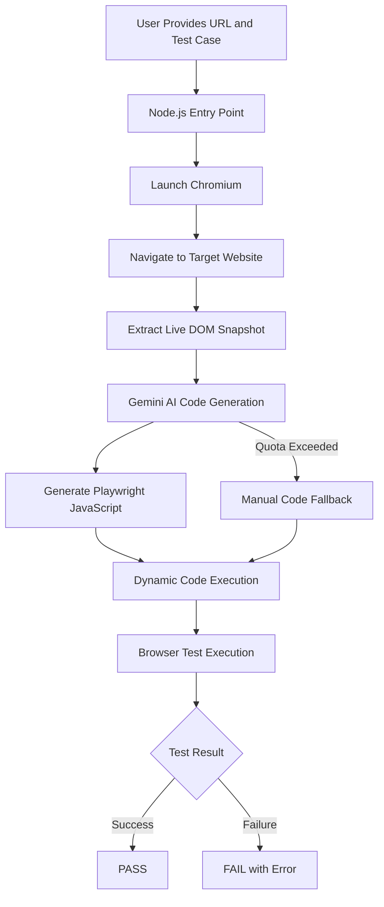

# CloudQA Task 2 – Plain-English Test Automator

An AI-powered browser testing automation tool that converts plain-English test cases into executable Playwright JavaScript code using Google Gemini AI. The system inspects the live DOM, generates context-aware test scripts, executes them in a real browser, and reports test results.

## 🚀 Overview

The Plain-English Test Automator simplifies web application testing by allowing users to describe test scenarios in natural language instead of manually writing Playwright scripts.

The application uses Google Gemini AI to understand test requirements and generate Playwright code based on the current webpage's DOM snapshot. The generated code is dynamically executed using Playwright Chromium.

## 🎥 Assessment Video Demonstration

The following video demonstrates the implementation, workflow, and execution of the CloudQA Task 2 Plain-English Test Automator.

**[▶️ Watch CloudQA Task 2 Assessment Video](https://drive.google.com/file/d/1twqUL-Owwa-z4ixyHfODad7wprzhoeVM/view?usp=sharing)**

## ✨ Features

- **Plain-English Test Execution:** Convert natural-language test cases into automated browser tests.
- **AI-Powered Code Generation:** Generate Playwright JavaScript code using Google Gemini AI.
- **Live DOM Inspection:** Extract page titles, URLs, headings, links, buttons, and input fields.
- **Visible Element Filtering:** Identify visible DOM elements to reduce locator issues caused by hidden navigation elements.
- **Dynamic Playwright Execution:** Execute AI-generated JavaScript using an asynchronous function.
- **Browser Automation:** Launch Chromium and interact with real websites.
- **Navigation Verification:** Validate page navigation, URLs, headings, and page content.
- **Automated PASS/FAIL Reporting:** Detect test failures and display descriptive error messages.
- **Manual Fallback:** Allow users to enter Playwright code manually when Gemini API quota is exceeded.

## 🛠️ Tech Stack

| Technology | Purpose |
|---|---|
| Node.js | Runtime environment |
| JavaScript | Application logic |
| Google Gemini AI | Natural-language-to-code generation |
| Vercel AI SDK (`ai`) | AI model integration |
| `@ai-sdk/google` | Google Gemini provider |
| Playwright | Browser automation and test execution |
| Chromium | Browser engine |
| dotenv | Environment variable management |

## 🏗️ Project Architecture

```text
cloudqa-task2-automator/
│
├── src/
│   ├── index.js
│   │
│   ├── ai/
│   │   └── llmService.js
│   │
│   └── core/
│       └── testExecutor.js
│
├── .env
├── .gitignore
├── package.json
└── README.md
```

### Module Responsibilities

#### 1. `src/index.js` – Application Entry Point

- Accepts the target website URL and test case from command-line arguments.
- Initializes the automation workflow.
- Passes the test case and URL to the test executor.

#### 2. `src/ai/llmService.js` – AI Code Generation

- Integrates Google Gemini AI using the Vercel AI SDK.
- Constructs prompts using the test case and DOM snapshot.
- Generates executable Playwright JavaScript.
- Cleans the generated code before execution.
- Handles API quota errors with a manual code fallback.

#### 3. `src/core/testExecutor.js` – Browser Test Execution

- Launches Chromium using Playwright.
- Navigates to the target website.
- Extracts the live DOM snapshot.
- Sends the snapshot to the AI code generation service.
- Dynamically executes the generated code.
- Handles exceptions and reports PASS/FAIL results.

## 🔄 Workflow



## ⚙️ Installation and Setup

### Prerequisites

- Node.js installed
- npm installed
- Google Gemini API key
- Basic understanding of JavaScript

### 1. Clone the Repository

```bash
git clone <your-repository-url>
cd cloudqa-task2-automator
```

### 2. Install Dependencies

```bash
npm install
```

Install Playwright Chromium if needed:

```bash
npx playwright install chromium
```

### 3. Configure Environment Variables

Create a `.env` file in the project root:

```env
GOOGLE_GENERATIVE_AI_API_KEY=your_gemini_api_key
```

Alternatively, the application supports:

```env
GEMINI_API_KEY=your_gemini_api_key
```

Ensure that the configured Gemini model is available for your API key.

**Important:** Never commit your Gemini API key to version control.

### 4. Run the Application

```bash
node src/index.js
```

The application uses the default target website and test case if no arguments are supplied.

## 🧪 Usage

### Example 1: Verify Website Loading

```bash
node src/index.js "https://example.com" "Verify the page loads and contains the heading Example Domain"
```

### Example 2: Navigation Testing

```bash
node src/index.js "https://phptravels.com/demo" "Click on Pricing and verify the pricing page loads"
```

### Example 3: Complex Test Scenario

```bash
node src/index.js "https://phptravels.com/demo" "Verify the homepage loads, click the visible Pricing link, verify the pricing page URL and content, check that a visible heading and link exist, then navigate back to the homepage and verify it loads successfully."
```

## 📊 Sample Execution

```text
Starting Plain-English Test Automator...

Target Site: https://phptravels.com/demo
Test Case: "Click on Pricing and verify the pricing page loads"

🌐 Navigating to https://phptravels.com/demo...
🔍 Inspecting live DOM elements...
   Loaded Page Title: "PHPTRAVELS Demo: Try the Live Travel Booking Software"

⏳ Translating English to Playwright code via AI...

▶️ Running test steps in browser...

✅ RESULT: Test PASSED
```

## 🧠 Technical Highlights

### Live DOM-Based Code Generation

Instead of generating Playwright scripts solely from natural-language instructions, the application extracts relevant elements from the live webpage.

The DOM snapshot contains:

- Page title and URL
- Visible headings
- Visible links and their URLs
- Visible buttons
- Visible input fields and their attributes

This provides the AI with contextual information for generating more reliable locators.

### Dynamic Code Execution

The generated Playwright JavaScript is executed dynamically:

```javascript
const AsyncFunction =
    Object.getPrototypeOf(async function() {}).constructor;

const dynamicTest = new AsyncFunction('page', generatedCode);

await dynamicTest(page);
```

This allows the application to execute AI-generated test steps without creating a separate test file for every scenario.

### Automated Error Handling

The system catches execution errors and reports failures:

```text
❌ RESULT: Test FAILED
Reason: locator.waitFor: Timeout 10000ms exceeded.
```

Successful test execution produces:

```text
✅ RESULT: Test PASSED
```

### Manual Fallback

When Gemini API quota is exceeded, the application prompts the user to provide Playwright JavaScript manually, allowing the test execution workflow to continue without another AI request.

## 🔐 Security Considerations

AI-generated JavaScript is dynamically executed within the Node.js process.

For production usage, generated code should be executed in a restricted sandbox with controlled browser access, resource limits, and appropriate security policies.

The Gemini API key should be stored securely in environment variables and must not be committed to version control.

## 🎯 Future Enhancements

- Screenshot capture for failed tests
- Detailed test execution reports
- Support for multiple test cases in a single run
- AI-powered self-healing locators
- Test history and result persistence
- Retry mechanism for flaky tests
- Structured JSON test reports
- Improved execution sandboxing

## 👨‍💻 Author

**Sandipan Nayek**

Competitive Programmer | MERN Stack Developer

GitHub: [SandipanNayek](https://github.com/SandipanNayek)

---

Developed as part of the CloudQA Task 2 assessment.
